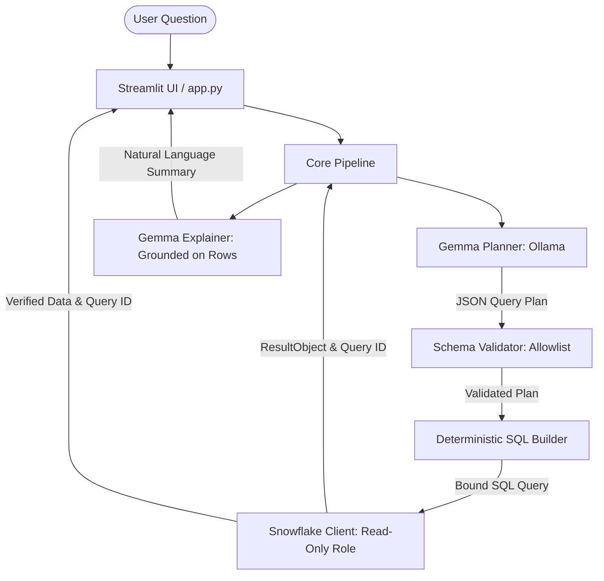

# DataMind (PS1: Talk to Your Data)

> **Problem Statement (PS1 – DataMind: Talk to Your Data):** Create an AI-powered data experience that lets people ask questions in everyday language and get useful answers grounded in the available data, with enough explanation that users trust the response reflects the information actually examined. The system must compute answers from real data, show the query, rows or sources, flag gaps, and change its answer when the data changes.
>
> *ZeroDay OSS Hacktoberfest 2026 – Gemma Hack Day, IIIT Dharwad. Required technologies: Snowflake + Google Gemma.*
> *Team: Digital Prospectors*

---

## 1. Team: Team Digital Prospectors

| Name | GitHub Handle | Role |
| :--- | :--- | :--- |
| Member 1 (Lead / Full Stack) | @sukanyakharate398-star | Architecture, Gemma Planner & Pipeline |
| Member 2 (Data / Backend) | @chinmayee123456 | Snowflake Schema, Validator & SQL Builder |
| Member 3 (UI / Evaluation) | @sharonsamuelhalli | Streamlit Frontend, Eval Suite & Docs |

---

## 2. Overview

DataMind is an open-source, trustworthy Natural Language Data Interface that allows non-technical users to ask plain-English questions about enterprise data stored in Snowflake. Rather than allowing an LLM to generate unconstrained SQL (which risks hallucinations and syntax/security errors) or invent answers, DataMind:
1. Translates questions into a deterministic JSON query plan using local Google Gemma (via Ollama).
2. Validates the plan against an allowlist derived from dataset configuration YAML.
3. Constructs parameter-bound SQL deterministically.
4. Executes the query in Snowflake using a restricted read-only role (`DATAMIND_APP_ROLE`).
5. Generates a natural-language explanation grounded strictly on verified query result rows.

*Example:*
* **Question**: "What are the top 5 customer market segments by total sales in 1995?"
* **Result**: Verified Snowflake results with query ID, execution time, parameter-bound SQL, and grounded summary explanation.

---

## 3. How It Works



### Separation of Concerns
* **Snowflake**: Stores source dataset tables, executes validated parameter-bound SQL queries in real-time, enforces read-only access controls, and provides immutable audit verification (`query_id`).
* **Google Gemma**: Interprets user intent into structured JSON query plans and provides concise, conversational explanations strictly grounded on the returned result rows. Gemma **never** writes raw SQL and **never** invents data values.

---

## 4. Key Features

* **Natural-Language Querying**: Express questions in everyday English.
* **Real Queries at Question Time**: Zero mock data, zero hardcoded answers; live queries run directly against Snowflake.
* **Strict Grounding & Verification**: Model explanations are checked against returned result values to eliminate hallucinations.
* **Inspectable Evidence Bundle**: Full audit transparency displaying the executed SQL, parameters, result rows, and Snowflake query ID (`sfqid`).
* **Honest Edge Handling**: Explicit handling for ambiguous questions, empty result sets, missing columns, and unsupported queries.
* **Read-Only Safeguards**: Application connects strictly via `DATAMIND_APP_ROLE`, preventing write, drop, or alter actions.

---

## 5. Tech Stack & Tested Environment

* **Operating System**: Windows 11 (PowerShell)
* **Python**: 3.13 (Virtual environment)
* **LLM Engine**: Ollama running locally (CPU inference)
* **Model Tag**: `gemma3n:e2b` (configured via `OLLAMA_MODEL`)
* **Hardware**: 8 GB RAM, CPU-only inference
* **Cloud Warehouse**: Snowflake (XS Warehouse `DATAMIND_WH`, DB `DATAMIND_DB`, Schema `SALES`)
* **Key Libraries**: `streamlit`, `snowflake-connector-python`, `pyyaml`, `ollama`, `pytest`, `python-dotenv`, `pandas`

---

## 6. Prerequisites

* Python 3.12+ installed
* Ollama installed and running locally (`http://localhost:11434`)
* Snowflake account with administrative access to run the initial setup script

---

## 7. Setup

### 1. Snowflake Setup
Run `scripts/setup_snowflake.sql` in your Snowflake worksheet as `ACCOUNTADMIN`. This creates the warehouse, database, schema, copies sample TPCH tables, and creates the read-only user and role.

### 2. Ollama Model Setup
Ensure Ollama is running and pull the model:
```powershell
ollama pull gemma3n:e2b
```

### 3. Environment & Dependencies
```powershell
# Create virtual environment (if not already created)
python -m venv .venv

# Activate virtual environment
.\.venv\Scripts\Activate.ps1

# Install dependencies
pip install -r requirements.txt
```

### 4. Configuration
Copy the template and fill in your credentials:
```powershell
Copy-Item .env.example .env
```
Edit `.env` with your Snowflake account details, user, and password.

---

## 8. Run

Start the Streamlit application:
```powershell
.\.venv\Scripts\Activate.ps1
streamlit run app.py
```

---

## 9. Configuration

### Environment Variables
| Variable | Description | Default |
| :--- | :--- | :--- |
| `SNOWFLAKE_ACCOUNT` | Snowflake account locator or organization identifier | *Required* |
| `SNOWFLAKE_USER` | Read-only application user | `DATAMIND_APP_USER` |
| `SNOWFLAKE_PASSWORD` | Application user password | *Required* |
| `SNOWFLAKE_ROLE` | Role enforcing read-only privileges | `DATAMIND_APP_ROLE` |
| `SNOWFLAKE_WAREHOUSE` | Compute warehouse | `DATAMIND_WH` |
| `SNOWFLAKE_DATABASE` | Target database | `DATAMIND_DB` |
| `SNOWFLAKE_SCHEMA` | Target schema | `SALES` |
| `OLLAMA_MODEL` | Ollama model tag for Gemma | `gemma3n:e2b` |
| `OLLAMA_HOST` | Ollama service endpoint | `http://localhost:11434` |
| `DATASET_CONFIG` | Path to dataset YAML configuration | `config/datasets/tpch.yaml` |

### Adding a Second Dataset
To configure a new dataset without modifying Python code, add a new configuration file in `config/datasets/<dataset_name>.yaml` and point `DATASET_CONFIG` to it in `.env`.

---

## 10. Dataset

* **Source**: `SNOWFLAKE_SAMPLE_DATA.TPCH_SF1` (Standard TPC-H benchmark dataset).
* **Tables Used**: `CUSTOMER`, `ORDERS`, `LINEITEM`, `NATION`, `REGION`.
* **Licence Status**: TPC Benchmark specification data provided as standard Snowflake sample data.
* **Preparation**: Copied into isolated database `DATAMIND_DB.SALES` via `CREATE TABLE ... AS SELECT` (CTAS) statements in `scripts/setup_snowflake.sql`.

---

## 11. Testing & Evaluation

### Run Test Suite
```powershell
pytest -v
```

### Run Evaluation Suite
```powershell
python scripts/run_eval.py
```
*Results will be logged and summarized in `docs/eval_summary.md`.*

---

## 12. Reproduce the Demo

1. **Standard Question**: Ask "What are the top 5 customer market segments by total sales?" -> Inspect returned rows, SQL, and query ID.
2. **Changed-Data Demo**: Run `scripts/demo_change_data.sql` in Snowflake to modify a single row, re-run the question, and verify the answer updates live.
3. **Ambiguity Handling**: Ask "Show me the best regions" -> App flags missing metric and asks for clarification.
4. **Unsupported Request**: Ask "Predict next quarter's revenue" -> App gracefully declines with an explanation.

---

## 13. Evaluating Without a Live Snowflake Account

Reviewers can verify DataMind's implementation and provenance through:
1. Recorded evidence bundles and query IDs in `docs/eval_summary.md`.
2. Self-contained tests in `tests/test_validator.py` and `tests/test_sql_builder.py` that run offline without external connections.
3. Demo video link and execution logs documenting live execution.

---

## 14. Troubleshooting

* **Snowflake Auth / MFA**: Ensure service user `DATAMIND_APP_USER` uses the assigned password or key-pair authentication without interactive MFA blocking.
* **Ollama Connection**: Verify Ollama is running at `http://localhost:11434` via `ollama list`.
* **Slow CPU Inference**: Keep query plan schema compact and prompts concise for 8GB RAM CPU execution.

---

## 15. Known Limitations

* Queries are constrained to analytical `SELECT` statements supported by the schema allowlist.
* Complex multi-nested subqueries or recursive queries are intentionally rejected by design for security.
* Model explanation speed is bound by local CPU capabilities.

---

## 16. Technical Contribution

DataMind introduces a deterministic, zero-hallucination bridge between local edge LLMs (Google Gemma) and cloud data warehouses (Snowflake). By decoupling intent extraction from SQL compilation through a schema-validated intermediate representation, DataMind guarantees both query safety and numeric grounding while running efficiently on standard commodity hardware.

---

## 17. Project Structure

```
├── .env.example
├── .gitignore
├── LICENSE
├── README.md
├── requirements.txt
├── app.py
├── config/
│   └── datasets/
│       └── tpch.yaml
├── docs/
│   ├── architecture.md
│   └── eval_summary.md
├── scripts/
│   ├── demo_change_data.sql
│   ├── run_eval.py
│   ├── setup_snowflake.sql
│   ├── smoke_gemma.py
│   └── smoke_snowflake.py
├── src/
│   ├── __init__.py
│   ├── config.py
│   ├── core/
│   │   ├── __init__.py
│   │   ├── evidence.py
│   │   ├── pipeline.py
│   │   ├── plan_schema.py
│   │   ├── sql_builder.py
│   │   └── validator.py
│   ├── db/
│   │   ├── __init__.py
│   │   └── snowflake_client.py
│   └── llm/
│       ├── __init__.py
│       ├── explainer.py
│       └── planner.py
└── tests/
    ├── __init__.py
    ├── eval_questions.csv
    ├── test_pipeline.py
    ├── test_sql_builder.py
    └── test_validator.py
```

---

## 18. Licence & Acknowledgements

* **Code Licence**: MIT License.
* **Google Gemma**: Used under the Gemma Terms of Use.
* **Snowflake Sample Data**: Derived from TPC-H benchmark data provided by Snowflake.
