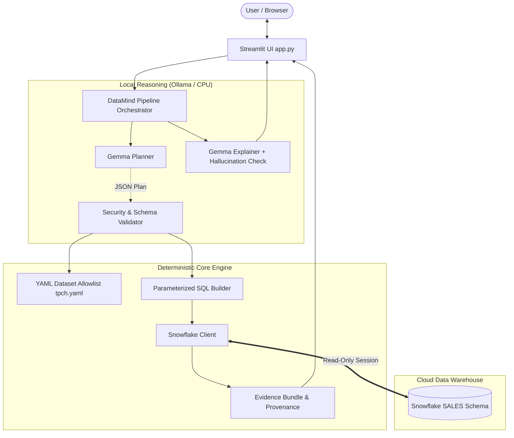

# DataMind Architecture & Security Model

## 1. System Overview

DataMind is a zero-hallucination natural language analytical assistant that bridges natural language questions and cloud data warehouses. It leverages a local small language model (**Gemma 3n 2B** via Ollama) strictly for intent understanding and semantic planning, paired with **Snowflake** for high-performance deterministic SQL execution.

---

## 2. Architectural Separation: Gemma vs Snowflake

| Responsibility | Gemma 3n (Local LLM via Ollama) | Snowflake Cloud Data Warehouse |
| :--- | :--- | :--- |
| **Primary Role** | Schema mapping, query planning, natural language explanation | Scalable, deterministic query execution and aggregation |
| **Output** | Structured JSON Plan (`intent`, `metrics`, `dims`, `filters`) | Real-time tabular data rows, column metadata, query ID (`sfqid`) |
| **SQL Writing** | **NEVER writes SQL** | Executes verified, parameterized SELECT queries |
| **Computation** | Zero math or metric calculations | All calculations (SUM, AVG, COUNT, GROUP BY, ORDER BY, LIMIT) |
| **Execution Environment** | Local CPU (optimized for 8 GB RAM, temperature 0, 30m keep-alive) | Cloud Warehouse (`DATAMIND_WH`) |

---

## 3. End-to-End Pipeline Workflow

1. **User Question Input**: The user submits a question via the Streamlit web interface or CLI pipeline.
2. **Pre-Selection & Prompt Construction**: Tables and columns are pre-filtered using synonym and keyword matching against `config/datasets/tpch.yaml` to ensure concise prompt token counts.
3. **Structured Planning (Gemma)**:
   - Gemma is constrained by Ollama's `format` parameter to return valid JSON following the strict `Plan` schema.
   - Ambiguous queries without clear metrics are flagged with `intent: clarify`.
   - Out-of-domain, forecasting, or predictive questions are flagged with `intent: unsupported`.
4. **Allowlist Security Validator**:
   - Validates that every table, column, and aggregate function exists in the YAML allowlist.
   - Rejects non-query intents from executing SQL.
   - Automatically establishes shortest-path join relationships between required tables using graph traversal.
   - Enforces default and maximum query limits (`default_limit: 100`, `max_limit: 1000`).
5. **Parameterized SQL Generation**:
   - Constructs a single, clean `SELECT` statement.
   - All filter values are bound as named parameters (`%(p0)s`, `%(p1)s`).
   - Semicolons and multiple statements are strictly prohibited.
6. **Snowflake Execution**:
   - Query executed with statement timeout (30 seconds) and maximum row limit.
   - Read-only app role (`DATAMIND_APP_ROLE`) prevents any data mutations (`INSERT`, `UPDATE`, `DELETE`, `DROP`).
   - Query ID (`sfqid`) and latency are captured.
7. **Zero-Hallucination Explainer**:
   - Gemma receives the question and up to 20 result rows.
   - Generates a concise 2-3 sentence summary.
   - **Deterministic Post-Check**: Every number present in the generated text is scanned and verified against the actual numbers in the query result rows. If any hallucinated or unverified number is detected, DataMind automatically falls back to a deterministic, data-backed template explanation.
8. **Evidence & Provenance Bundle**:
   - The UI displays the verified answer, SQL query with parameters, result rows, query ID, execution latency, and model metadata.

---

## 4. Security & Safety Model

- **Read-Only Database Role**: The application connects using `DATAMIND_APP_ROLE`, which has only `SELECT` privileges on the `SALES` schema. Any `UPDATE` or DDL statement is rejected at the database level.
- **No SQL Generation by LLM**: The LLM outputs structured JSON plans only. It has zero capability to generate SQL syntax, preventing prompt injection attacks targeting database syntax.
- **Parameterized Queries**: All user-provided values are passed as bound parameters, fully neutralizing SQL injection attempts (e.g. `'; DROP TABLE ORDERS; --`).
- **Secret Sanitization**: Error messages and stack traces are scanned to scrub passwords, tokens, and connection strings before display.
